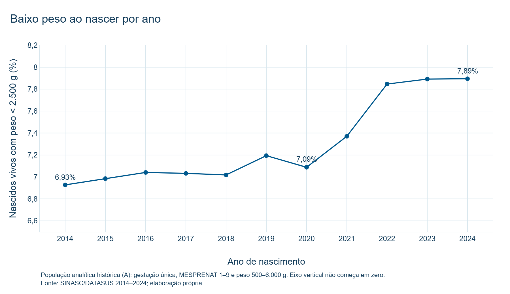
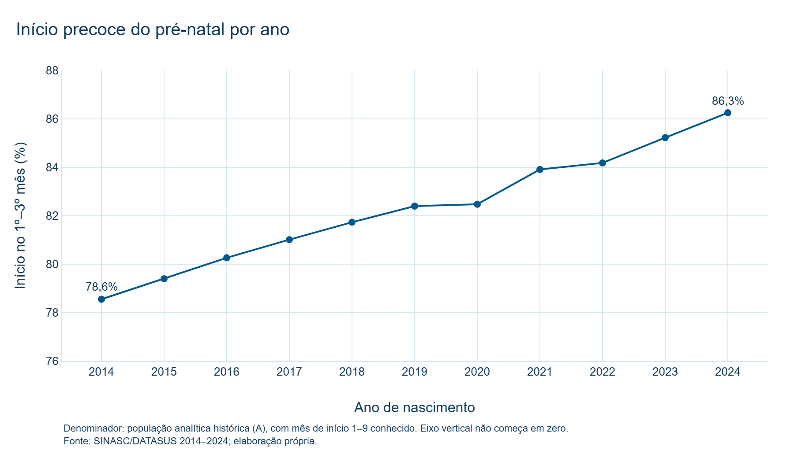
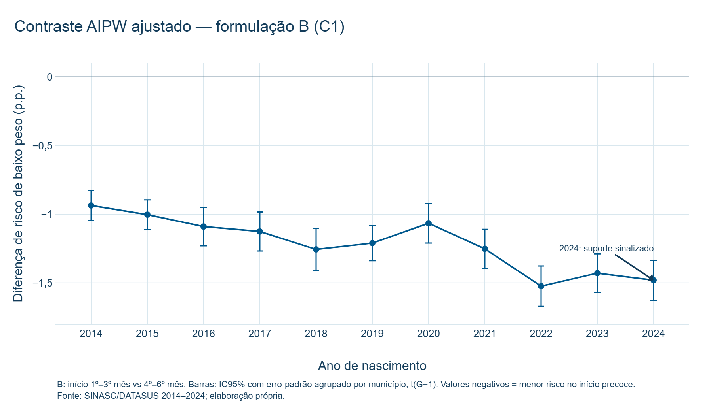
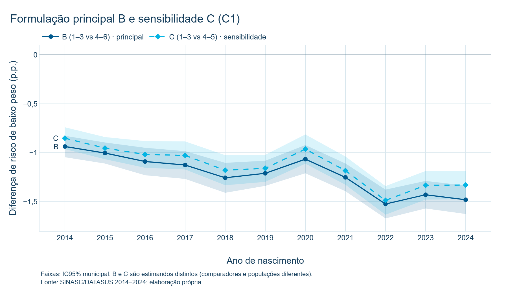
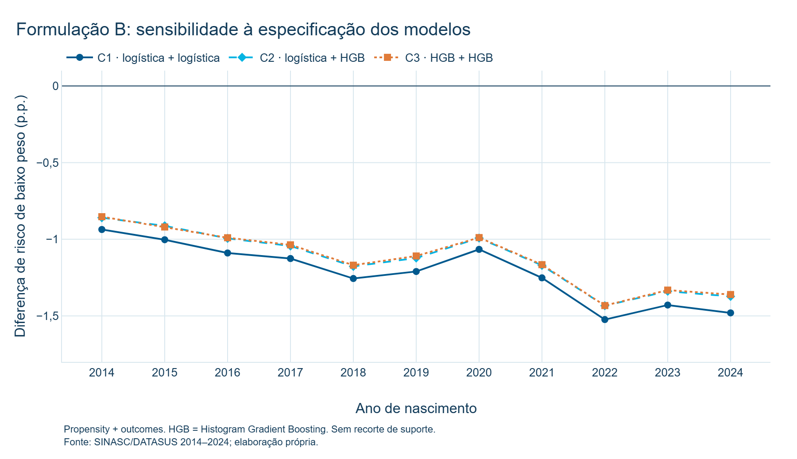

# Início precoce do pré-natal e baixo peso ao nascer no Brasil, 2014–2024

**Título provisório.** Início precoce do pré-natal e baixo peso ao nascer no Brasil, 2014–2024: contrastes AIPW com ajuste cruzado em 30,5 milhões de registros do SINASC.

**Disciplina:** Big Data & Analytics — Mestrado IPT, 2026.3.
**Notebook científico de referência:** `notebooks/historico/10_estimacao_v2.ipynb` (retirado da árvore em outubro de 2026; disponível no histórico Git, commit `e11bee6`).
**Fonte numérica:** [outputs/temporal/estimacao_v2/](../../outputs/temporal/estimacao_v2/) e tabelas temporais descritivas. Todos os números deste texto foram conferidos automaticamente contra esses arquivos.

---

## 1. Título provisório

*Início precoce do pré-natal e baixo peso ao nascer no Brasil, 2014–2024: contrastes AIPW com ajuste cruzado em 30,5 milhões de registros do SINASC.*

## 2. Resumo

O baixo peso ao nascer (peso inferior a 2.500 g) é um dos principais marcadores de risco neonatal. Este trabalho investiga se, entre gestantes comparáveis em características observáveis, iniciar o pré-natal até o 3º mês de gestação está associado a um risco menor de baixo peso, em comparação com iniciar entre o 4º e o 6º mês. Foram usados os microdados públicos do Sistema de Informações sobre Nascidos Vivos (SINASC/DATASUS) de 2014 a 2024: 30.468.409 registros brutos, um por nascido vivo. A população analítica principal (formulação B) reúne 27.533.362 nascidos vivos de gestação única, com peso válido e mês de início do pré-natal entre 1 e 6.

O método é o estimador duplamente robusto AIPW (*Augmented Inverse Probability Weighting*), com ajuste cruzado (*cross-fitting*) em três partições, sete covariáveis maternas e geográficas e três especificações de modelos auxiliares. A incerteza é medida com erros-padrão agrupados por município de residência. Em todos os onze anos, o contraste AIPW ajustado é negativo, ou seja, o risco estimado de baixo peso é menor no início precoce. Na especificação C1, ele varia de −0,936 p.p. (2014) a −1,524 p.p. (2022), e em 2024 é de −1,480 p.p. (IC95% municipal −1,626 a −1,335). Nenhum intervalo de confiança inclui zero. O padrão é preservado na sensibilidade C (comparador 4º–5º mês), nas três especificações de modelo e no recorte de suporte [0,05; 0,95].

Os resultados são estimativas sob hipóteses de identificação, e não um efeito causal comprovado. O estudo é observacional, há confundimento residual plausível (renda, tabagismo, nutrição, morbidades), a população é condicionada ao nascimento vivo e o mês de início do pré-natal é registrado retrospectivamente.

**Palavras-chave:** pré-natal; baixo peso ao nascer; SINASC; inferência causal; AIPW; *cross-fitting*.

## 3. Contexto e problema

O pré-natal é a principal porta de entrada da gestante no sistema de saúde. O Ministério da Saúde recomenda iniciá-lo no primeiro trimestre, para permitir rastreamentos, suplementação e o manejo precoce de condições de risco. O baixo peso ao nascer (BPN) é um desfecho perinatal relevante: associa-se a mortalidade neonatal e a morbidades ao longo da vida. A Organização Mundial da Saúde define BPN como peso inferior a 2.500 g, independentemente da idade gestacional.

A literatura brasileira mostra que a inadequação do pré-natal está associada a maiores chances de BPN (Vale et al., 2021) e que escolaridade, raça/cor, idade e paridade maternas também se associam ao desfecho (Falcão et al., 2020). O desafio é que as mulheres que iniciam o pré-natal cedo diferem sistematicamente das que iniciam tarde: em escolaridade, situação conjugal, região e acesso a serviços. Uma comparação bruta mistura o possível papel do pré-natal com essas diferenças de perfil. A revisão de Corman, Dave e Reichman (2018) descreve essa literatura como "confusa" justamente por esse problema de identificação.

Do ponto de vista de Big Data, o SINASC oferece uma oportunidade rara: a cobertura é praticamente censitária, com cerca de 2,4 a 3,0 milhões de nascidos vivos por ano. Isso permite estimar contrastes ajustados com grande precisão estatística, ano a ano, e observar sua evolução temporal. Por outro lado, grande volume não resolve confundimento: a precisão aumenta, mas o viés não diminui. Por isso, o trabalho combina engenharia de dados em larga escala (DuckDB e Parquet) com um desenho de inferência causal explícito e honesto sobre as próprias limitações.

## 4. Pergunta de pesquisa

> Entre gestantes comparáveis em idade, escolaridade, raça/cor, situação conjugal, paridade, perdas fetais anteriores e UF de residência, iniciar o pré-natal até o 3º mês de gestação está associado a um risco menor de baixo peso ao nascer do que iniciar entre o 4º e o 6º mês? Essa diferença se mantém entre 2014 e 2024?

A grandeza estimada (o **estimando**) é, para cada ano, uma diferença média padronizada de risco, em pontos percentuais (p.p.):

ψ = E[ m₁(X) − m₀(X) ],

em que m₁(X) e m₀(X) são os riscos esperados de BPN com início precoce e com início tardio, para uma gestante com características X. Valores negativos indicam menor risco no início precoce.

## 5. Fonte de dados

- **Sistema:** SINASC — Sistema de Informações sobre Nascidos Vivos.
- **Instituição:** Ministério da Saúde, Secretaria de Vigilância em Saúde e Ambiente / DATASUS.
- **Acesso:** Portal de Dados Abertos do SUS. Um arquivo ZIP com CSV por ano (`SINASC_{ano}_csv.zip`), baixado em 25/09/2026 (2024) e 29/09/2026 (2014–2023).
- **Documento de base:** cada registro corresponde a uma Declaração de Nascido Vivo (DNV), preenchida no estabelecimento de saúde ou em cartório.
- **Documentação oficial usada:** *SINASC: Estrutura de 1996 a 2019 — Dicionário de Dados* (MS/SVS/CGIAE) e *Declaração de Nascido Vivo: manual de instruções para preenchimento*, 4ª edição (MS, 2022).

Os arquivos brutos foram preservados byte a byte, com SHA-256 registrado, e convertidos para Parquet sem alterar valores: todas as colunas permanecem como texto. Detalhes, tamanhos e hashes estão em [METADADOS_BASE.md](METADADOS_BASE.md).

## 6. Metadados da base

| Item | Valor |
| --- | --- |
| Período | 2014–2024 (11 anos) |
| Cobertura | Brasil, 27 UFs, cerca de 5.580 municípios de residência por ano |
| Registros brutos | 30.468.409 (de 2.389.325 em 2024 a 3.017.668 em 2015) |
| Colunas por ano | 61 (2014–2022) e 62 (2023–2024, com o campo `OPORT_DN`) |
| Formato original | CSV (separador `;`, UTF-8) dentro de ZIP |
| Formato analítico | Parquet, colunas texto; consultas em DuckDB |
| População analítica histórica (A) | 28.194.211 |
| População principal (B) | 27.533.362 |
| População de sensibilidade (C) | 26.860.501 |

O detalhamento por ano está em [METADADOS_BASE.md](METADADOS_BASE.md) e o dicionário completo das 62 colunas, em [DICIONARIO_TECNICO.md](DICIONARIO_TECNICO.md).

## 7. Granularidade

**Uma linha corresponde a um nascido vivo, ou seja, a uma DNV.** Não há identificador da mãe: gestações sucessivas da mesma mulher não podem ser ligadas, e gêmeos geram uma DNV cada. A chave operacional usada no projeto é a combinação (ano, UF de residência, `CONTADOR`). Ela é única em todos os anos auditados, mas não é um identificador longitudinal estável entre extrações.

A análise é feita **separadamente para cada ano de nascimento**. Não há estimativa combinada (*pooled*) dos onze anos.

## 8. Target (desfecho Y)

| Elemento | Definição |
| --- | --- |
| Campo original | `PESO` (gramas) |
| Y = 1 | `PESO` < 2.500 g (baixo peso ao nascer) |
| Y = 0 | `PESO` ≥ 2.500 g |
| Regra de qualidade | elegível apenas com 500 g ≤ `PESO` ≤ 6.000 g |
| Prevalência | 6,93% (2014) a 7,19% (2019); 7,37% (2021); 7,85% a 7,89% (2022–2024) |

Em 2024, na população analítica histórica, a prevalência de BPN é de 7,894891% (N = 2.251.570). A regra de 500–6.000 g remove valores implausíveis. Em 2024, ela excluiu 3.471 registros após as demais regras (0,15%). A definição de BPN da OMS não depende da idade gestacional; por isso, o projeto não restringe a análise a nascimentos a termo.

*Figura 1. Prevalência de BPN na população analítica histórica (A). O eixo vertical não começa em zero.*

## 9. Exposição / tratamento (T)

A exposição é o **momento de início do pré-natal**, registrado no campo `MESPRENAT` (mês de gestação da primeira consulta). Como não se trata de um tratamento atribuído por sorteio, a palavra "tratamento" é usada no sentido técnico da inferência causal: a condição cuja associação com Y se quer isolar.

| Formulação | T = 1 (precoce) | T = 0 (comparador) | Papel |
| --- | --- | --- | --- |
| A — V1 histórica | `MESPRENAT` 1–3 | `MESPRENAT` 4–9 | referência histórica e controle positivo |
| **B — V2 principal** | `MESPRENAT` 1–3 | `MESPRENAT` 4–6 | **resultado principal** |
| C — sensibilidade | `MESPRENAT` 1–3 | `MESPRENAT` 4–5 | sensibilidade mais restritiva |
| D — *landmark* | — | — | pendente, não implementada |

**Por que B, e não A, é a formulação principal?** O mês de início só é registrado ao nascimento. Para uma gestante pertencer ao grupo "início no 7º, 8º ou 9º mês", a gestação precisa ter durado pelo menos até esse mês. Gestações que terminam cedo (partos prematuros, que concentram grande parte do BPN) quase não conseguem entrar nos meses tardios. Isso cria uma associação mecânica entre início tardio e menor prematuridade, o que contamina o contraste A (Vachuska, 2025; Hernán e Robins, 2025, §22.4). Restringir o comparador ao 4º–6º mês reduz quase totalmente essa região vulnerável e preserva cerca de 87% dos controles de A. Isso **reduz, mas não elimina** o problema temporal.

Regras adicionais:

- `MESPRENAT` = 99 e vazio ficam fora de T. O código 99 é tratado como codificação operacional observada de "ignorado", sem confirmação literal no manual de 2022, e não é interpretado como ausência de pré-natal.
- `CONSPRENAT` = 0 não é convertido em controle.
- Restringir o comparador muda a população e o estimando: **A, B e C são três estimandos distintos**, e não três medições da mesma grandeza.

*Figura 2. Proporção de início no 1º–3º mês na população A: de 78,55% (2014) a 86,25% (2024). O eixo vertical não começa em zero.*

## 10. Matriz X–T–Y

Em cada ano, os dados analíticos são organizados em três blocos:

| Bloco | Dimensão | Conteúdo |
| --- | --- | --- |
| **X** | n × 7 | X1 idade materna · X2 escolaridade · X3 raça/cor · X4 situação conjugal · X5 paridade · X6 perdas fetais · X7 UF de residência |
| **T** | n × 1 | 1 = início no 1º–3º mês; 0 = início no 4º–6º mês (B) |
| **Y** | n × 1 | 1 = peso < 2.500 g; 0 = peso ≥ 2.500 g |

Em 2024, na formulação B, n = 2.207.214. Em inferência causal, T não é "mais uma coluna" de X: ele tem papel próprio. O modelo de propensão usa X para explicar T, e os modelos de desfecho usam X para explicar Y separadamente em cada braço de T. A explicação didática completa está em [MATRIZ_XTY.md](MATRIZ_XTY.md).

**Variáveis deliberadamente excluídas de X:** `SEMAGESTAC`/`GESTACAO` (idade gestacional), `CONSPRENAT`/`CONSULTAS` (número de consultas), `PARTO`, `APGAR1`/`APGAR5` e `KOTELCHUCK`. Elas são medidas depois do início do pré-natal ou no parto, podem ser mediadoras do caminho pré-natal → peso, ou funcionam como *collider* (idade gestacional). Ajustar por elas introduziria viés em vez de removê-lo (Wilcox, Weinberg e Basso, 2011; Schisterman, Cole e Platt, 2009).

## 11. Desenho observacional

Trata-se de um **estudo observacional transversal repetido**, com onze cortes anuais, e não de um experimento. Ninguém sorteou o mês de início do pré-natal. Para que o contraste ajustado possa ser lido como causal, são necessárias quatro hipóteses:

1. **Intercambialidade condicional:** dado X, o grupo que iniciou cedo e o que iniciou tarde seriam comparáveis quanto ao risco de BPN. Ou seja, não há confundidor importante fora de X. Essa é a hipótese mais forte, e ela **não é verificável** com os dados.
2. **Positividade:** para cada perfil X, existem gestantes nos dois grupos. Essa hipótese é verificada empiricamente (seção 21).
3. **Consistência:** "iniciar o pré-natal no 1º–3º mês" corresponde a uma condição suficientemente bem definida. Na prática, ela agrega qualidades de atendimento muito diferentes.
4. **Ausência de interferência:** o início do pré-natal de uma gestante não altera o desfecho de outra.

Há também **seleção por nascido vivo**: o SINASC registra apenas gestações que terminaram em nascimento vivo. Perdas gestacionais e natimortos não aparecem, e restringir a análise aos nascidos vivos condiciona a um possível *collider* (Snowden et al., 2018; Vachuska, 2025). O estimando é, portanto, definido **na população de nascidos vivos elegíveis** e não se generaliza automaticamente para todas as gestações.

Em síntese, o resultado é um **contraste AIPW ajustado**: uma estimativa causal *sob hipóteses de identificação*, e não um efeito causal comprovado.

## 12. Preparação dos dados

O fluxo é inteiramente reprodutível e executado com DuckDB sobre Parquet:

1. **Ingestão:** download dos ZIPs oficiais, verificação de CRC e SHA-256 e conversão CSV → Parquet com todas as colunas como texto, preservando zeros à esquerda e códigos originais.
2. **Auditoria por ano:** schema, domínios, duplicidade da chave, datas e ausência de campos essenciais. Os onze anos foram admitidos; 2014–2017 com harmonização documentada da chave (`CONTADOR` não é único isoladamente nesses anos, mas a chave composta é).
3. **Elegibilidade (exemplo de 2024):**

| Etapa | Regra | Excluídos | Restantes |
| --- | --- | ---: | ---: |
| Base bruta | — | — | 2.389.325 |
| A0 | T conhecido (`MESPRENAT` 1–9) e `PESO` numérico positivo | 81.079 | 2.308.246 |
| A1 | 500 g ≤ `PESO` ≤ 6.000 g | 3.471 | 2.304.775 |
| A2 | gestação única (`GRAVIDEZ` = 1) | 53.205 | 2.251.570 |
| B | exclui `MESPRENAT` 7–9 do comparador | 44.356 | 2.207.214 |
| C | exclui também `MESPRENAT` 6 | 42.020 | 2.165.194 |

4. **Construção de X:** recodificações explícitas e auditáveis. Por exemplo, código 9 vira `IGNORADO` e perdas fetais são agrupadas em 0, 1 ou 2 ou mais. A idade só é aceita entre 10 e 59 anos. Missing em variáveis categóricas recebe categoria própria e não remove registros. Ver [DICIONARIO_TECNICO.md](DICIONARIO_TECNICO.md).
5. **Missing principais (população analítica):** em 2024, perdas fetais 1,88%, raça/cor 1,25%, situação conjugal 0,61% e escolaridade 0,48%. Em 2014, perdas fetais 8,37% e raça/cor 3,45%. O percentual de `MESPRENAT` desconhecido (99 ou vazio) na base bruta caiu de 7,57% (2014) para 3,39% (2024).

## 13. Método AIPW

O AIPW combina dois modelos auxiliares, também chamados de *nuisance models*:

- o **escore de propensão** e(X) = P(T = 1 | X), que descreve quem tende a iniciar o pré-natal cedo;
- os **modelos de desfecho** m₁(X) = E[Y | T = 1, X] e m₀(X) = E[Y | T = 0, X], que descrevem o risco de BPN em cada grupo.

Para cada nascido vivo i, calcula-se uma contribuição individual (o *escore de influência*):

ψᵢ = m₁(Xᵢ) − m₀(Xᵢ) + Tᵢ·(Yᵢ − m₁(Xᵢ)) / e(Xᵢ) − (1 − Tᵢ)·(Yᵢ − m₀(Xᵢ)) / (1 − e(Xᵢ)).

A estimativa é a média dos ψᵢ. A intuição é a seguinte: a primeira parte (m₁ − m₀) é uma previsão do contraste; as duas últimas corrigem essa previsão com os erros observados, ponderados pelo inverso da probabilidade de pertencer ao grupo. O estimador é **duplamente robusto**: permanece consistente se pelo menos um dos dois modelos estiver bem especificado, sob as hipóteses da seção 11 (Funk et al., 2011). A dupla robustez protege contra erro de *modelagem*, mas **não** contra confundimento não medido.

## 14. Cross-fitting (ajuste cruzado)

Quando os mesmos dados são usados para ajustar e para avaliar os modelos auxiliares, o sobreajuste contamina a estimativa. O ajuste cruzado evita esse problema (Chernozhukov et al., 2018; Zivich e Breskin, 2021):

1. os registros de cada ano são divididos em **3 partições**, estratificadas pelas quatro combinações de (T, Y) — o estrato 2·T + Y —, com semente fixa 20240925;
2. para cada partição, os modelos são ajustados nas outras duas e usados para prever a partição deixada de fora;
3. assim, cada nascido vivo recebe e(X), m₀(X) e m₁(X) de modelos que **nunca viram aquele registro**.

Os modelos são reajustados do zero em cada formulação (A, B, C), ano e partição. Não há reaproveitamento de predições da V1 nem dos diagnósticos anteriores.

## 15. Modelos auxiliares

| Especificação | Propensão e(X) | Desfechos m₀, m₁ |
| --- | --- | --- |
| **C1** | regressão logística L2 (C = 1) | regressões logísticas L2, uma por braço |
| C2 | regressão logística L2 (C = 1) | *Histogram Gradient Boosting* (HGB) |
| C3 | HGB | HGB (os mesmos de C2) |

- **Pré-processamento logístico:** idade com imputação pela mediana, indicador de ausência e padronização; categóricas em *one-hot*.
- **HGB:** 100 iterações no máximo, 15 folhas, mínimo de 100 registros por folha, taxa de aprendizado 0,1, regularização L2 = 1, variáveis categóricas nativas e parada antecipada interna.
- **Hiperparâmetros:** fixados antes da V2, sem *tuning* e sem busca pelo "melhor" modelo.
- **Diagnóstico da propensão (B, C1):** AUC entre 0,661 e 0,690. Isso indica separação moderada entre os grupos — bom para a positividade. O maior desequilíbrio padronizado (|SMD|) cai de 0,37–0,44 antes da ponderação para no máximo 0,024 depois. O tamanho efetivo de amostra dos controles (ESS/N) fica entre 0,664 e 0,749.
- **Modelos de desfecho:** AUC entre 0,57 e 0,60. O valor é baixo, mas esperado: sete variáveis sociodemográficas explicam pouco do peso ao nascer. A calibração é boa (erro máximo por faixa ≤ 0,008), e é a calibração que importa para o AIPW.

C1 é a especificação de referência por ser a mais simples e transparente. C2 e C3 verificam se a flexibilidade do modelo muda a conclusão.

## 16. Inferência

- **Leitura principal:** erro-padrão **agrupado por município de residência** (`CODMUNRES`, cerca de 5.580 municípios), com intervalo de confiança baseado na distribuição t com G − 1 graus de liberdade. Nascimentos do mesmo município compartilham serviços e contexto, e tratá-los como independentes subestimaria a incerteza (Cameron e Miller, 2015).
- **Referência:** erro-padrão iid (independência entre registros), mantido para comparação histórica.
- O erro-padrão municipal é de 1,10 a 1,47 vez o iid em B (1,04 a 1,38 em C).
- **Principal:** sem recorte do escore de propensão. **Sensibilidade:** recorte em [0,05; 0,95].

**Controle positivo.** Antes de estimar B e C, o novo código reproduziu a V1 (formulação A, 2024): **141 de 141 verificações aprovadas**, com diferença máxima de 2,2 × 10⁻¹⁶ contra uma tolerância de 10⁻¹². Os valores reproduzidos foram C1 = −1,3405 p.p., C2 = −1,2315 p.p. e C3 = −1,2325 p.p. Só depois disso a V2 foi liberada.

**Limites da inferência:** o IC municipal não modela dependência entre anos. Diferenças entre anos **não** são testes formais. O IC reflete apenas variação amostral, e não viés de confundimento ou de seleção.

## 17. Resultados descritivos

| Ano | N bruto | N analítico (A) | Y = 1 (%) | Início precoce, A (%) | N B |
| --- | ---: | ---: | ---: | ---: | ---: |
| 2014 | 2.979.259 | 2.691.119 | 6,93 | 78,55 | 2.615.773 |
| 2019 | 2.849.146 | 2.645.383 | 7,19 | 82,40 | 2.586.743 |
| 2020 | 2.730.145 | 2.535.311 | 7,09 | 82,48 | 2.476.058 |
| 2022 | 2.561.922 | 2.397.626 | 7,85 | 84,18 | 2.344.255 |
| 2024 | 2.389.325 | 2.251.570 | 7,89 | 86,25 | 2.207.214 |

A tabela completa está em [TABELAS_RESULTADOS.md](TABELAS_RESULTADOS.md#tabela-1--perfil-da-base-por-ano). Três movimentos descritivos se destacam:

1. o número de nascidos vivos cai cerca de 20% entre 2015 e 2024;
2. a proporção de início precoce cresce continuamente, de 78,55% para 86,25%;
3. a prevalência de BPN sobe, sobretudo entre 2020 e 2022.

A diferença bruta de risco entre início precoce e tardio na formulação A, em 2024, é de −1,424 p.p. Ela **não é causal**: mistura o pré-natal com as diferenças de perfil materno.

## 18. Resultados principais — formulação B

| Ano | N | C1 (p.p.) | IC95% municipal C1 | C2 (p.p.) | C3 (p.p.) | Suporte |
| --- | ---: | ---: | :---: | ---: | ---: | --- |
| 2014 | 2.615.773 | −0,936 | −1,046 a −0,827 | −0,859 | −0,853 | Aprovado |
| 2015 | 2.673.272 | −1,003 | −1,111 a −0,896 | −0,913 | −0,920 | Aprovado |
| 2016 | 2.560.827 | −1,090 | −1,230 a −0,949 | −0,994 | −0,990 | Aprovado |
| 2017 | 2.630.828 | −1,126 | −1,268 a −0,984 | −1,044 | −1,036 | Aprovado |
| 2018 | 2.672.423 | −1,256 | −1,409 a −1,103 | −1,177 | −1,169 | Aprovado |
| 2019 | 2.586.743 | −1,210 | −1,339 a −1,082 | −1,122 | −1,109 | Aprovado |
| 2020 | 2.476.058 | −1,066 | −1,210 a −0,922 | −0,992 | −0,989 | Aprovado |
| 2021 | 2.425.844 | −1,252 | −1,394 a −1,110 | −1,171 | −1,166 | Aprovado |
| 2022 | 2.344.255 | −1,524 | −1,671 a −1,377 | −1,433 | −1,432 | Aprovado |
| 2023 | 2.340.125 | −1,429 | −1,570 a −1,288 | −1,339 | −1,332 | Aprovado |
| 2024 | 2.207.214 | −1,480 | −1,626 a −1,335 | −1,373 | −1,361 | **Sinalizado** |

**Leitura.** Em todos os anos, o risco padronizado de BPN é menor no grupo que iniciou o pré-natal até o 3º mês do que no grupo que iniciou entre o 4º e o 6º mês. A diferença vai de cerca de 0,9 a 1,5 ponto percentual, diante de uma prevalência geral de BPN em torno de 7–8%. Todos os ICs municipais estão inteiramente abaixo de zero: o maior limite superior de C1 é −0,827 p.p. (2014).

**Ano sinalizado.** Em B/2024, a fração de registros com escore de propensão fora de [0,05; 0,95] é de 10,56%, acima do limite de alerta de 10% fixado antes da estimação, no notebook 09d. A sinalização indica caudas mais pesadas, compostas predominantemente por tratados com propensão alta (223.170 dos 232.984 registros fora do intervalo). Ela **não** indica falha de positividade: nenhum registro fica fora de [0,01; 0,99]. Por isso, o ano é mantido e reportado com a ressalva.

*Figura 3. Contraste AIPW ajustado (B, C1) com IC95% municipal.*

## 19. Sensibilidade C

A formulação C usa como comparador apenas o início no 4º ou 5º mês. Ela afasta ainda mais o comparador da região afetada pelo problema temporal, mas remove mais controles e muda a população e o estimando.

| Ano | C1 (p.p.) | IC95% municipal C1 | Suporte |
| --- | ---: | :---: | --- |
| 2014 | −0,851 | −0,963 a −0,740 | Aprovado |
| 2018 | −1,179 | −1,333 a −1,025 | Sinalizado |
| 2020 | −0,963 | −1,112 a −0,814 | Sinalizado |
| 2022 | −1,487 | −1,633 a −1,341 | Sinalizado |
| 2024 | −1,330 | −1,475 a −1,184 | Sinalizado |

A tabela completa está em [TABELAS_RESULTADOS.md](TABELAS_RESULTADOS.md#tabela-3--formulação-c-sensibilidade-sem-recorte). C reproduz o mesmo padrão de B, com magnitudes ligeiramente menores: C1 de C é menos negativo que C1 de B em todos os anos, por 0,037 p.p. (2022) a 0,150 p.p. (2024). Todos os ICs municipais permanecem abaixo de zero. Os anos 2017–2024 de C estão sinalizados pelo mesmo critério de caudas, já que o comparador menor aumenta a proporção de tratados. Nenhum ano foi bloqueado ou removido.

*Figura 4. Formulações B e C (C1) com faixas de IC95% municipal.*

## 20. Sensibilidade de modelo (C1, C2, C3)

- **C2 e C3 são praticamente iguais entre si:** a maior diferença anual é de 0,013 p.p. em B e de 0,012 p.p. em C. Trocar a propensão logística pela HGB quase não muda o resultado.
- **C1 é sistematicamente mais negativo:** fica entre 0,07 e 0,12 p.p. abaixo de C2 e C3, em B e em C. A diferença decorre dos modelos de desfecho (logístico × HGB) e é pequena diante da magnitude do contraste.
- O sinal, a ordem de grandeza e a forma da série temporal são os mesmos nas três especificações.

*Figura 5. Formulação B nas três especificações.*

## 21. Trimming (recorte de suporte)

O recorte em [0,05; 0,95] exclui os registros com escore de propensão extremo e recalcula o AIPW sobre os restantes, usando as mesmas predições do ajuste cruzado.

| | B | C |
| --- | --- | --- |
| Registros excluídos (C1) | 6,22% a 10,56% | 8,14% a 14,94% |
| Maior mudança absoluta em C1 | 0,067 p.p. (2023) | 0,096 p.p. (2023) |
| Maior limite superior do IC após o recorte (todas as especificações) | −0,760 p.p. | −0,687 p.p. |
| Registros fora de [0,01; 0,99] | 0 | 0 |

O recorte não muda materialmente a leitura: os sinais se mantêm, as mudanças são inferiores a 0,1 p.p. e nenhum IC passa a incluir zero. Como o recorte também muda a população-alvo (Crump et al., 2009; Petersen et al., 2012), ele é apenas sensibilidade, e nunca foi escolhido em função do resultado. Detalhe anual em [TABELAS_RESULTADOS.md](TABELAS_RESULTADOS.md#tabela-4--recorte-de-suporte-trimming-c1).

## 22. Evolução temporal

Descritivamente, B e C seguem o mesmo desenho ao longo do tempo (Figura 4):

- a magnitude do contraste cresce de 2014 (B: −0,936 p.p.) até 2018–2019 (B: −1,256 e −1,210 p.p.);
- há recuo em 2020 (B: −1,066 p.p.);
- a magnitude volta a crescer em 2021 (B: −1,252 p.p.);
- a maior magnitude ocorre em 2022 (B: −1,524 p.p.);
- a magnitude permanece elevada em 2023–2024 (B: −1,429 e −1,480 p.p.).

A V1 histórica (A) mostra o mesmo desenho, com magnitudes menores (de −0,849 p.p. em 2014 a −1,388 p.p. em 2022).

**O que essa evolução não autoriza:**

- não foi feito teste formal de quebra estrutural, nem de diferença entre anos;
- os ICs anuais não incorporam dependência entre anos;
- o recuo de 2020 **não** é atribuído à pandemia de COVID-19;
- o pico de 2022 **não** é atribuído a nenhuma política ou evento.

Essas hipóteses exigiriam desenhos próprios. No mesmo período também mudam a prevalência de BPN, a proporção de início precoce e a composição da população. A série é, portanto, um retrato descritivo de contrastes anuais, e não uma série de efeitos de intervenções.

## 23. Limitações

1. **Dados observacionais:** não há aleatorização. A interpretação causal depende da hipótese de intercambialidade condicional, que não é verificável.
2. **Confundimento residual:** renda, tabagismo, estado nutricional, morbidades prévias, gravidez planejada ou não e acesso efetivo a serviços não estão (ou não estão completamente) no SINASC. Gestantes mais saudáveis e com mais recursos tendem a iniciar cedo, o que pode inflar a magnitude do contraste.
3. **Seleção por nascido vivo:** perdas gestacionais e natimortos não são observados. Condicionar ao nascimento vivo pode introduzir viés.
4. **Mensuração de `MESPRENAT`:** o campo é preenchido retrospectivamente, sem validação direta conhecida, e a categoria desconhecida (99 ou vazio) é excluída. O significado oficial do código 99 não foi confirmado literalmente.
5. **Problema temporal residual:** B reduz substancialmente a incompatibilidade entre a duração da gestação e a classificação do tratamento, mas não a elimina. A formulação *landmark* (D), que resolveria o tempo zero, permanece pendente: os dados não distinguem "ainda não iniciou" de "desconhecido".
6. **Inferência:** o IC municipal não modela dependência temporal entre anos, e diferenças anuais não são testes entre anos.
7. **Anos sinalizados:** B/2024 e C/2017–2024 têm caudas de propensão acima do limite de alerta. Foram mantidos e reportados.
8. **Qualidade de covariáveis:** perdas fetais tiveram baixa concordância em validações locais do modelo antigo da DNV (Bonilha et al., 2018), e a sensibilidade sem essa variável não foi executada.
9. **Consistência:** "início precoce" agrega cuidados de qualidade e conteúdo muito diferentes.

## 24. Conclusão

Com 27,5 milhões de nascidos vivos na população principal, entre 2014 e 2024, o início do pré-natal até o 3º mês está associado, após ajuste por sete características maternas e geográficas, a um risco de baixo peso ao nascer entre 0,9 e 1,5 ponto percentual menor do que o início entre o 4º e o 6º mês. Esse contraste AIPW ajustado:

- é negativo em todos os onze anos;
- tem ICs municipais inteiramente abaixo de zero;
- é estável entre especificações de modelo e ao recorte de suporte;
- reaparece na formulação C, mais restritiva.

A principal contribuição metodológica do trabalho é mostrar como um problema de Big Data pode ser tratado com disciplina causal. O volume foi processado de forma reprodutível e auditável. O estimando foi definido antes dos resultados, e a formulação histórica foi revisada quando se identificou uma ameaça temporal concreta. Cada resultado vem acompanhado de suas hipóteses e limites. A conclusão substantiva é compatível com a recomendação de iniciar o pré-natal no primeiro trimestre, mas, por se tratar de estimativa sob hipóteses de identificação, **não comprova um efeito causal** nem quantifica o ganho de uma intervenção específica.

## 25. Próximos passos

Estes passos já estavam previstos no contrato metodológico e não foram executados nesta entrega:

1. análise de sensibilidade a confundimento não medido (E-value; VanderWeele e Ding, 2017);
2. sensibilidade sem a variável de perdas fetais;
3. formulação *landmark* (D), caso surja informação que distinga "ainda não iniciou" de "desconhecido";
4. testes formais de mudança temporal, com inferência que considere a dependência entre anos;
5. heterogeneidade do contraste por perfil (CATE), apenas como análise exploratória.

## 26. Referências

### Documentação oficial do SINASC

- BRASIL. Ministério da Saúde. Portal de Dados Abertos do SUS. *Sistema de Informação sobre Nascidos Vivos — SINASC*. Disponível em: <https://dadosabertos.saude.gov.br/dataset/sistema-de-informacao-sobre-nascidos-vivos-sinasc>. Acesso em: 25 e 29 set. 2026.
- BRASIL. Ministério da Saúde. SVS/CGIAE. *SINASC: Estrutura de 1996 a 2019 — Dicionário de Dados — Evolução Temporal dos Campos*. Brasília, [s.d.]. Arquivo local `data/raw/SINASC_Estrutura.pdf`.
- BRASIL. Ministério da Saúde. Secretaria de Vigilância em Saúde. *Declaração de Nascido Vivo: manual de instruções para preenchimento*. 4. ed. Brasília: Ministério da Saúde, 2022.
- WORLD HEALTH ORGANIZATION. *Low birthweight* (indicador NLIS). Disponível em: <https://www.who.int/data/nutrition/nlis/info/low-birth-weight>. Acesso em: 25 set. 2026.

### Estudos sobre pré-natal, baixo peso e qualidade do SINASC

- BONILHA, E. A. et al. Coverage, completeness and reliability of the data in the Information System on Live Births in public maternity wards in the municipality in São Paulo, Brazil, 2011. *Epidemiologia e Serviços de Saúde*, v. 27, e201712811, 2018. DOI: 10.5123/S1679-49742018000100011.
- CORMAN, H.; DAVE, D. M.; REICHMAN, N. *Effects of prenatal care on birth outcomes: reconciling a messy literature*. NBER Working Paper 24885, 2018. DOI: 10.3386/w24885.
- FALCÃO, I. R. et al. Factors associated with low birth weight at term: a population-based linkage study of the 100 million Brazilian cohort. *BMC Pregnancy and Childbirth*, v. 20, 536, 2020. DOI: 10.1186/s12884-020-03226-x.
- SZWARCWALD, C. L. et al. Avaliação das informações do Sistema de Informações sobre Nascidos Vivos (SINASC), Brasil. *Cadernos de Saúde Pública*, v. 35, n. 10, e00214918, 2019. DOI: 10.1590/0102-311X00214918.
- VACHUSKA, K. Can early prenatal care initiation reduce racial inequalities in birth outcomes? A causal decomposition approach. *SSM – Population Health*, v. 31, 101838, 2025. DOI: 10.1016/j.ssmph.2025.101838.
- VALE, C. C. R.; ALMEIDA, N. K. O.; ALMEIDA, R. M. V. R. Association between prenatal care adequacy indexes and low birth weight outcome. *Revista Brasileira de Ginecologia e Obstetrícia*, v. 43, p. 256–263, 2021. DOI: 10.1055/s-0041-1728779.
- VIELLAS, E. F. et al. Assistência pré-natal no Brasil. *Cadernos de Saúde Pública*, v. 30, supl. 1, p. S85–S100, 2014. DOI: 10.1590/0102-311X00126013.

### Referências metodológicas

- AUSTIN, P. C.; STUART, E. A. Moving towards best practice when using inverse probability of treatment weighting (IPTW) using the propensity score to estimate causal treatment effects in observational studies. *Statistics in Medicine*, v. 34, p. 3661–3679, 2015. DOI: 10.1002/sim.6607.
- CAMERON, A. C.; MILLER, D. L. A practitioner's guide to cluster-robust inference. *Journal of Human Resources*, v. 50, p. 317–372, 2015. DOI: 10.3368/jhr.50.2.317.
- CHERNOZHUKOV, V. et al. Double/debiased machine learning for treatment and structural parameters. *The Econometrics Journal*, v. 21, p. C1–C68, 2018. DOI: 10.1111/ectj.12097.
- CRUMP, R. K.; HOTZ, V. J.; IMBENS, G. W.; MITNIK, O. A. Dealing with limited overlap in estimation of average treatment effects. *Biometrika*, v. 96, n. 1, p. 187–199, 2009. DOI: 10.1093/biomet/asn055.
- FUNK, M. J. et al. Doubly robust estimation of causal effects. *American Journal of Epidemiology*, v. 173, p. 761–767, 2011. DOI: 10.1093/aje/kwq439.
- HERNÁN, M. A.; ROBINS, J. M. *Causal Inference: What If*. Boca Raton: Chapman & Hall/CRC. Versão de 21 nov. 2025.
- PETERSEN, M. L. et al. Diagnosing and responding to violations in the positivity assumption. *Statistical Methods in Medical Research*, v. 21, p. 31–54, 2012. DOI: 10.1177/0962280210386207.
- SCHISTERMAN, E. F.; COLE, S. R.; PLATT, R. W. Overadjustment bias and unnecessary adjustment in epidemiologic studies. *Epidemiology*, v. 20, n. 4, p. 488–495, 2009. DOI: 10.1097/EDE.0b013e3181a819a1.
- SNOWDEN, J. M. et al. The curse of the perinatal epidemiologist: inferring causation amidst selection. *Current Epidemiology Reports*, v. 5, p. 379–387, 2018. DOI: 10.1007/s40471-018-0172-x.
- VANDERWEELE, T. J.; DING, P. Sensitivity analysis in observational research: introducing the E-value. *Annals of Internal Medicine*, v. 167, n. 4, p. 268–274, 2017. DOI: 10.7326/M16-2607.
- WILCOX, A. J.; WEINBERG, C. R.; BASSO, O. On the pitfalls of adjusting for gestational age at birth. *American Journal of Epidemiology*, v. 174, n. 9, p. 1062–1068, 2011. DOI: 10.1093/aje/kwr230.
- ZIVICH, P. N.; BRESKIN, A. Machine learning for causal inference: on the use of cross-fit estimators. *Epidemiology*, v. 32, n. 3, p. 393–401, 2021. DOI: 10.1097/EDE.0000000000001332.

*Nota sobre as referências:* todas constam da biblioteca do projeto ([REFERENCIAS_CENTRAIS.md](../literature/REFERENCIAS_CENTRAIS.md)) ou da biblioteca local de fichamentos citada no [contrato V2](../temporal/CONTRATO_V2_PRE_ESTIMACAO.md). Nenhuma referência foi adicionada sem leitura prévia registrada.
